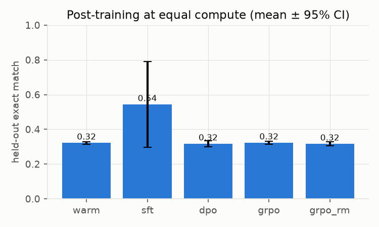
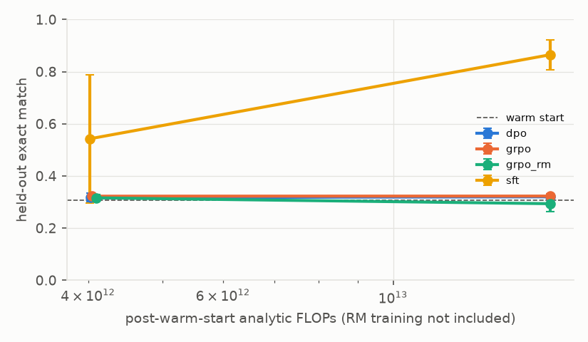
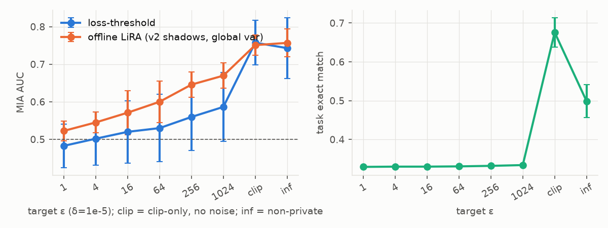
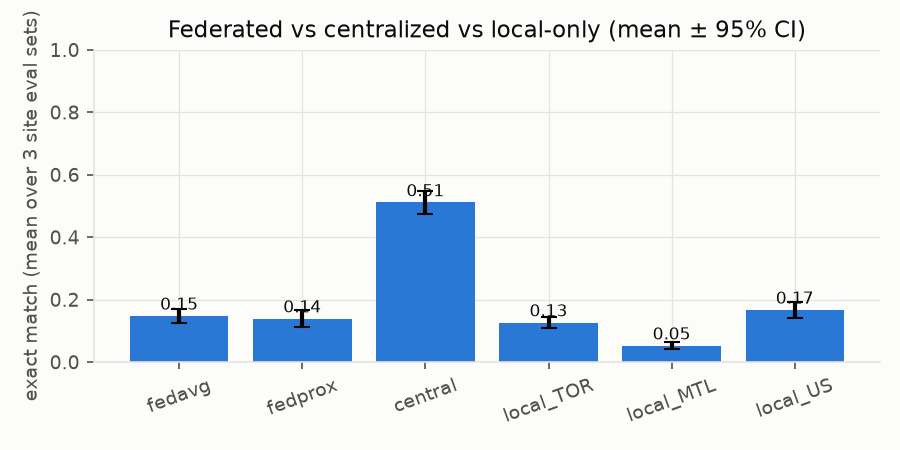

# M8 — Post-training & privacy extension: report

Generated by `uv run python -m bench.m8_report`; tables are rendered from `results/m8/*/summary.json`.

## Task and model

- **Task** (`data/synth/qa.py`): questions about a hidden synthetic statement from `data/synth/finance.py`
  (category totals, counts, closing balance, largest charge by merchant or amount, and the difference between two
  categories). Questions use paraphrase templates and category synonyms ("eating out" -> dining). The model must
  call tools (`total`, `count`, `closing`, `largest`, `calc`), and the environment inserts `R: <result>` lines.
  *Exact match* means the final `A:` line equals the gold answer. *Tool-call success* means at least one call was
  made and every call line parsed and executed. The held-out eval set (seed 777) uses statements never seen in
  training.
- **Model** (`posttrain/model.py`): our own char-level causal transformer (4 layers, d=128, 4 heads), with
  KV-cached batched decoding and tool interleaving. No HF model was used: downloads are restricted on this
  network, and a tiny own model keeps Opacus per-sample gradients simple.
- **Warm start**: LM pretraining on public synthetic statements/transcripts, then SFT on gold tool-use
  episodes. Every method starts from the same per-seed warm start.

## Equal-compute comparison: methodology

The budget is **analytic FLOPs spent after the warm start**: 2N per token for every forward pass (sampling,
reference-model and reward-model scoring) and 6N per token for forward+backward. N is the total parameter
count, and the attention term is ignored (T <= 256). Each method runs until its ledger reaches the budget
(overshoot of at most one batch). Wall-clock is reported, but it was measured on a heavily shared machine
(load average far above core count from unrelated jobs), so it is only indicative.

- **SFT (continued)**: more *gold-labelled* episodes. This is the only method with demonstrations beyond the
  warm start.
- **DPO (iterative/online)**: per round, prompts x 4 samples (T=1) from the current policy. Pairs are best vs
  worst under the *verifiable* reward (exact + 0.1*tool_ok), beta=0.1, against a fixed warm-start reference.
- **GRPO**: groups of 8 samples per prompt. Group-normalised advantages, one on-policy step per batch
  (ratio = 1), k3 KL to the reference (0.02), and the verifiable reward.
- **GRPO-RM**: the same, but the reward is a learned **reward model**'s P(correct) (+0.1 verifiable tool
  validity). The RM is a scalar-head copy of the warm-start trunk, trained on warm-start rollouts labelled by
  correctness and evaluated on held-out rollouts. RM scoring during GRPO is charged to the budget. RM *training*
  compute is reported per seed (`reward_model.rm_compute`) and is **not** charged.
- LR per method was picked from a 2-value grid on a separate dev split with a separate tuning seed (`tune.json`).

Source: `results/m8/posttrain/summary.json` (n=5 seeds; per-seed files `results/m8/posttrain/seed*.json`). Post-warm-start budget per method: 4.0e+12 analytic FLOPs.

| method | exact match (mean [95% CI]) | tool-call success | FLOPs used | wall-clock s (shared machine) |
|---|---|---|---|---|
| warm | 0.322 [0.313, 0.330] | 0.887 [0.860, 0.913] | 1.86e+13 | 69 |
| sft | 0.543 [0.297, 0.789] | 0.961 [0.935, 0.986] | 4.02e+12 | 21 |
| dpo | 0.317 [0.300, 0.333] | 0.998 [0.996, 1.000] | 4.03e+12 | 409 |
| grpo | 0.322 [0.313, 0.332] | 0.975 [0.938, 1.013] | 4.05e+12 | 259 |
| grpo_rm | 0.316 [0.304, 0.328] | 0.945 [0.890, 1.000] | 4.09e+12 | 156 |

Per question type (mean exact match over seeds):

| method | total | count | closing | largest_m | largest_a | diff |
|---|---|---|---|---|---|---|
| warm | 0.00 | 0.93 | 0.00 | 1.00 | 0.01 | 0.00 |
| sft | 0.35 | 0.99 | 0.42 | 1.00 | 0.50 | 0.02 |
| dpo | 0.00 | 0.94 | 0.00 | 0.97 | 0.00 | 0.00 |
| grpo | 0.00 | 0.94 | 0.00 | 1.00 | 0.00 | 0.00 |
| grpo_rm | 0.00 | 0.90 | 0.00 | 1.00 | 0.00 | 0.00 |

Pairwise Welch tests on exact match (p uncorrected; Hedges g):

| comparison | rel. diff | p (Welch) | g |
|---|---|---|---|
| dpo_vs_sft | -0.416 | 0.0633 | -1.45 |
| dpo_vs_grpo | -0.017 | 0.441 | -0.47 |
| dpo_vs_grpo_rm | +0.003 | 0.916 | 0.06 |
| grpo_vs_sft | -0.406 | 0.0678 | -1.42 |
| grpo_vs_grpo_rm | +0.020 | 0.27 | 0.68 |
| grpo_rm_vs_sft | -0.418 | 0.0628 | -1.46 |

Reward model (held-out rollouts from warm-start policy): accuracy 0.975 [0.965, 0.985], AUC 0.995 [0.992, 0.998], positive rate 0.252 [0.244, 0.260].

LR selected on dev split (tuning seed 100): `{'sft': 0.001, 'dpo': 0.0003, 'grpo': 0.0001, 'grpo_rm': 0.0001}`.

Second budget, 4x larger (`results/m8/posttrain/budget1.6e13/summary.json`, n=5 seeds, same warm starts, LRs reused from the 4e12 tuning):

| method | exact match (mean [95% CI]) | tool-call success | FLOPs used | wall-clock s (shared machine) |
|---|---|---|---|---|
| warm | 0.308 [0.293, 0.322] | 0.881 [0.860, 0.903] | 1.86e+13 | 53 |
| sft | 0.865 [0.808, 0.922] | 0.990 [0.982, 0.997] | 1.60e+13 | 63 |
| dpo | 0.320 [0.311, 0.329] | 0.998 [0.996, 1.000] | 1.60e+13 | 778 |
| grpo | 0.323 [0.314, 0.332] | 0.997 [0.992, 1.001] | 1.60e+13 | 543 |
| grpo_rm | 0.294 [0.264, 0.323] | 0.713 [0.386, 1.040] | 1.60e+13 | 268 |

## DP-SGD and membership inference: methodology

- **Private step**: supervised fine-tuning of the *public* base LM (pretrained on public synthetic data only)
  on D_priv = private tool-use episodes plus member canaries. DP is **example-level** (one record = one
  episode or one canary), and per-example loss is the mean token CE over the record. Opacus
  `make_private_with_epsilon` uses Poisson sampling, per-sample clipping, and Gaussian noise. epsilon is reported by
  the RDP accountant, with the PRV accountant as a cross-check on the same (sigma, q, steps). The non-DP baseline
  uses the same batch size, epochs and LR, with no clipping/noise.
- **Canaries**: `note SYN-dddddddd pin dddd-dddd` with random digits. A fixed pool is split 50/50 per seed into
  members (each inserted once) and non-members (never trained on).
- **Attacks**: (a) loss threshold (Yeom et al. 2018); (b) offline LiRA (Carlini et al. 2022), with K=3 OUT shadow
  models per epsilon setting. Shadows use the same recipe on fresh task data plus same-format *reference*
  canaries from a disjoint pool (never the evaluated ones), and a Gaussian fit of logit confidence (per-canary
  or pooled variance); (c) shadow-calibrated loss (mean OUT loss minus target loss). AUC is reported as mean with a 95% CI across seeds; per-run
  bootstrap CIs are in the seed files.

Source: `results/m8/privacy/summary.json`. δ = 1e-05, clip C = 1.0, batch 128 (Poisson, rate in table), 6 epochs, lr 0.001, Opacus RDP accountant (PRV accountant as cross-check).

| target ε | ε spent (RDP) | ε (PRV) | σ (noise mult.) | steps | q | task exact match | loss-threshold MIA AUC | offline-LiRA AUC (global var) | offline-LiRA AUC (per-canary var) | shadow-calibrated AUC | LiRA (global var) TPR@1%FPR | seeds |
|---|---|---|---|---|---|---|---|---|---|---|---|---|
| ∞ (no DP) | — | — | — | 66 | 0.098 | 0.499 [0.457, 0.541] | 0.743 [0.662, 0.824] | 0.757 [0.720, 0.794] | 0.743 [0.693, 0.792] | 0.756 [0.720, 0.793] | 0.158 [0.130, 0.186] | 5 |
| clip-only, σ=0 (no DP) | — | — | 0.000 | 66 | 0.098 | 0.676 [0.638, 0.714] | 0.757 [0.698, 0.817] | 0.751 [0.724, 0.778] | 0.739 [0.694, 0.784] | 0.750 [0.724, 0.776] | 0.146 [0.063, 0.229] | 5 |
| 1024 | 1023.99 [1023.99, 1023.99] | 616.20 [616.20, 616.20] | 0.121 | 66 | 0.098 | 0.334 [0.331, 0.337] | 0.586 [0.495, 0.678] | 0.670 [0.636, 0.703] | 0.656 [0.628, 0.683] | 0.669 [0.634, 0.703] | 0.092 [0.013, 0.171] | 5 |
| 256 | 255.99 [255.99, 255.99] | 242.47 [242.47, 242.47] | 0.187 | 66 | 0.098 | 0.332 [0.330, 0.334] | 0.560 [0.470, 0.649] | 0.646 [0.613, 0.679] | 0.636 [0.614, 0.658] | 0.645 [0.612, 0.678] | 0.086 [0.017, 0.155] | 5 |
| 64 | 64.00 [64.00, 64.00] | 59.79 [59.79, 59.79] | 0.346 | 66 | 0.098 | 0.331 [0.329, 0.333] | 0.530 [0.440, 0.620] | 0.600 [0.544, 0.656] | 0.591 [0.539, 0.642] | 0.600 [0.544, 0.655] | 0.114 [-0.002, 0.230] | 5 |
| 16 | 15.99 [15.99, 15.99] | 14.99 [14.99, 14.99] | 0.630 | 66 | 0.098 | 0.330 [0.330, 0.330] | 0.520 [0.437, 0.603] | 0.571 [0.512, 0.630] | 0.563 [0.508, 0.617] | 0.570 [0.511, 0.629] | 0.040 [-0.018, 0.098] | 5 |
| 4 | 4.00 [4.00, 4.00] | 3.86 [3.86, 3.86] | 1.245 | 66 | 0.098 | 0.330 [0.330, 0.330] | 0.502 [0.431, 0.573] | 0.545 [0.518, 0.572] | 0.550 [0.524, 0.576] | 0.544 [0.517, 0.571] | 0.016 [-0.003, 0.035] | 5 |
| 1 | 1.00 [1.00, 1.00] | 1.00 [1.00, 1.00] | 3.281 | 66 | 0.098 | 0.329 [0.327, 0.331] | 0.483 [0.425, 0.541] | 0.523 [0.496, 0.549] | 0.530 [0.500, 0.561] | 0.522 [0.496, 0.549] | 0.006 [-0.005, 0.017] | 5 |

Shadow-based columns use the v2 shadows (`results/m8/privacy/mia_v2/`, `shadows_v2_eps*.json`): OUT models trained with a disjoint set of same-format reference canaries. The v1 shadows saw no canaries at all, which made LiRA saturate (AUC 0.5 by construction); v1 numbers stay in the seed files for the record.

Public task model *before* the private step (`results/m8/privacy/base_eval.json`): exact match 0.323, tool-call success 0.873.

## Federated fine-tuning: methodology

Three in-process sites (TOR, MTL: CAD; US: USD) have non-IID data: site-skewed merchant mixes and very different
question-type mixes (TOR mostly totals/counts, MTL closing/diff, US largest-charge). We compare FedAvg,
FedProx, centralized training on pooled data, and local-only training per site, all with the same total SGD
steps and the same public base as the privacy experiment. Evaluation is on held-out episodes per site from that
site's distribution, and "global" is the mean over sites. Communication is *accounted* (fp32 weights up and
down per site per round), not measured on a network.

Source: `results/m8/federated/summary.json` (n=5 seeds). 8 rounds × 10 local steps × 3 sites, batch 64; centralized and local-only baselines use the same total number of SGD steps.

| method | global exact (mean [95% CI]) | TOR | MTL | US |
|---|---|---|---|---|
| fedavg | 0.148 [0.126, 0.170] | 0.154 | 0.042 | 0.248 |
| fedprox | 0.139 [0.111, 0.168] | 0.114 | 0.040 | 0.264 |
| central | 0.511 [0.475, 0.548] | 0.524 | 0.324 | 0.686 |
| local_TOR | 0.127 [0.110, 0.143] | 0.254 | 0.024 | 0.102 |
| local_MTL | 0.053 [0.042, 0.064] | 0.076 | 0.040 | 0.042 |
| local_US | 0.167 [0.141, 0.194] | 0.102 | 0.054 | 0.346 |

Communication (accounted, fp32, no compression): 20.36 MB per round (3 sites × up+down × 848471 params), 162.9 MB total.
For comparison, pooling the raw site episodes for centralized training moves 0.17 MB (seed 0) — the toy data are far smaller than the model, so FL does not save bytes here.

- fedavg_vs_central: rel. diff -0.711, Welch p = 1.11e-07
- fedprox_vs_fedavg: rel. diff -0.059, Welch p = 0.525

## Findings (each quoted from the summaries above; details and caveats in `results/m8/NOTES.md`)

- **Post-training at equal analytic FLOPs**: only SFT on gold demonstrations improved exact match (4e12: 0.543,
  bimodal across seeds; 1.6e13: 0.865). DPO and GRPO with the verifiable reward raised tool-call validity
  but not exact match at either budget. The warm start scores 0 on three of six question types, so on-policy
  outcome rewards rarely see a success there (interpretation, not measured per type).
- **Reward hacking**: GRPO with the learned reward model (97% accurate on warm-start rollouts) drove its
  training reward to 0.67–1.0, while true exact match stayed flat or fell and tool validity collapsed on 3/5
  seeds (1.6e13 budget).
- **DP-SGD**: at every ε from 1 to 1024 (δ=1e-5, RDP; PRV agrees or is tighter), utility stays at the public
  model's level (0.33). Non-private fine-tuning gives 0.499 and clip-only (σ=0) gives 0.676, so the noise,
  not the clipping, removes the utility in this small-data, short-schedule regime. Offline-LiRA MIA AUC
  rises from 0.52 (ε=1) to 0.67 (ε=1024), against 0.76 non-private.
- **Federated (3 non-IID sites)**: FedAvg reaches 0.148 global EM vs 0.511 centralized, below the best
  local-only site, and moves 163 MB of weights against 0.17 MB of raw data. FedProx(0.01) and more frequent
  averaging do not help.

## Honest limits

- The model is tiny (see n_params in the seed files) and the task is templated. None of these numbers transfer
  to foundation-model scale. Even the *ranking* of SFT/DPO/GRPO may change with model size, budget and task.
- DP guarantees are example-level for this fine-tuning step only. They don't cover pretraining data (public
  synthetic), hyperparameter tuning (done on separate non-private data), or repeated records of one customer
  (group privacy scales epsilon). Opacus secure RNG was off, which is fine for research but not production.
- **Encryption != privacy**: M5 envelope encryption protects checkpoints at rest/in transit, but a model trained
  on private data can still leak it through its outputs, which is what the MIA measures. Only DP bounds that
  leakage.
- Federated learning alone gives **no formal privacy**: updates can leak data. The simulation is in-process,
  with no stragglers, dropouts, secure aggregation or real WAN.
